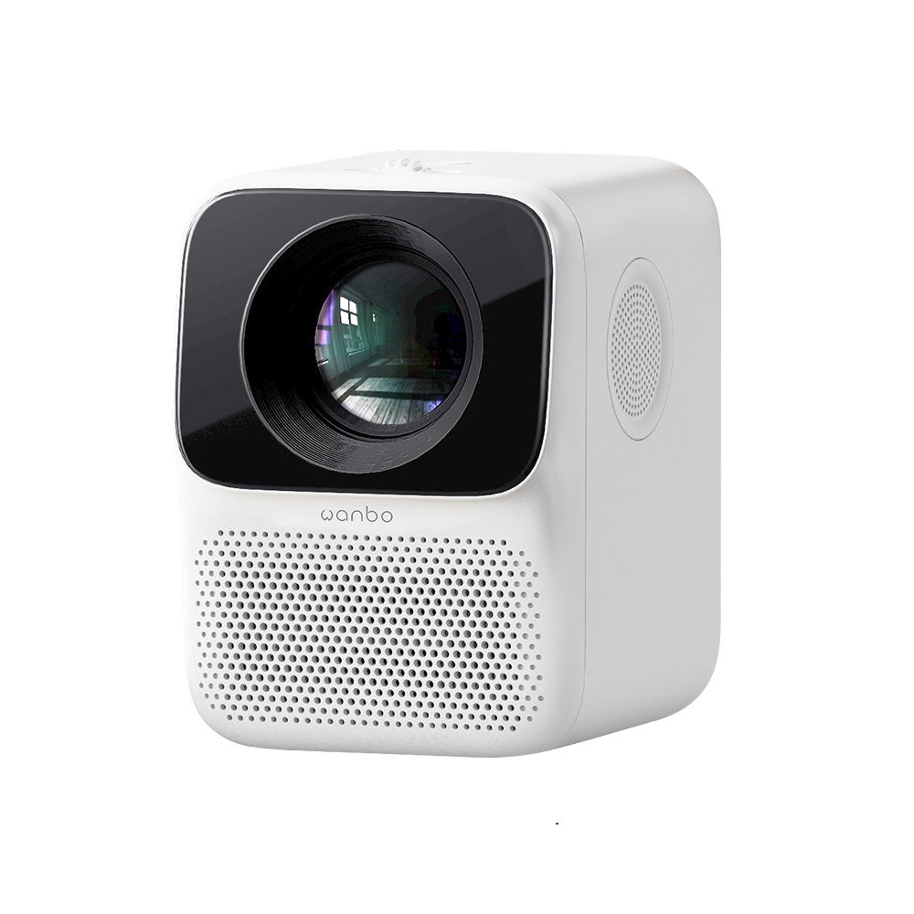
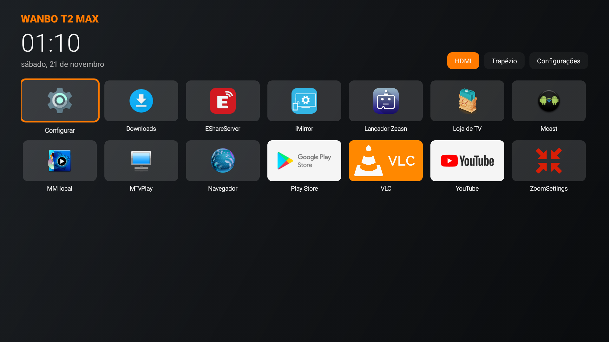
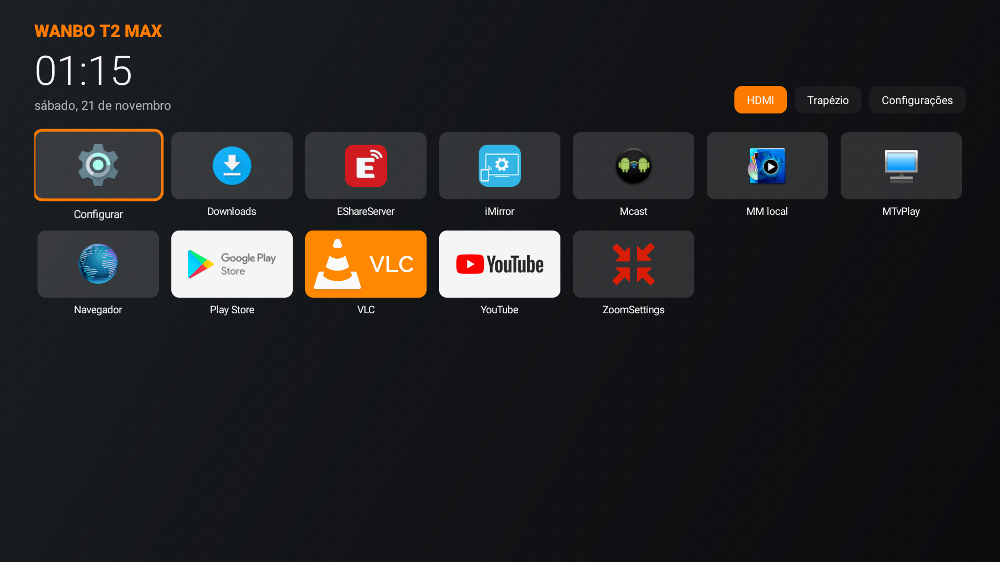
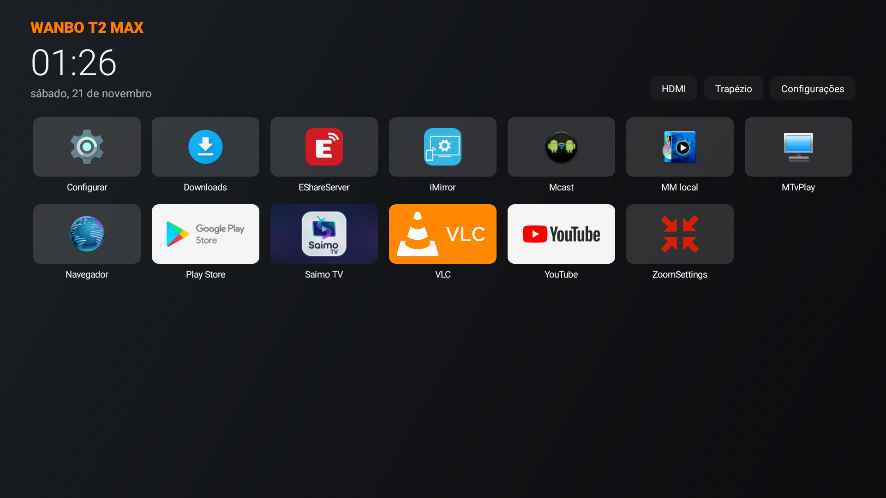
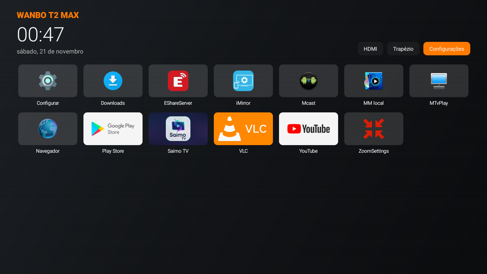
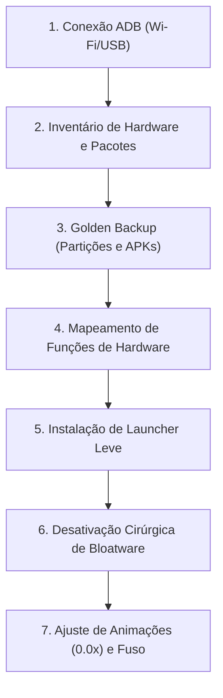

# 📽️ Wanbo T2 Max (T2 M+) · Guia Universal de Otimização, Debloat e Launcher Nativo

<p align="center">
  
</p>

<p align="center">
  <a href="https://github.com/DLMIDIA/Wanbo-T2-Max---update-projetor"></a>
  <a href="https://github.com/DLMIDIA/Wanbo-T2-Max---update-projetor/releases"></a>
  <a href="https://github.com/DLMIDIA/Wanbo-T2-Max---update-projetor"></a>
  <a href="https://github.com/DLMIDIA/Wanbo-T2-Max---update-projetor/blob/main/LICENSE"></a>
</p>

<p align="center">
  <b>Transforme seu projetor Wanbo T2 Max (ou qualquer outro projetor Android) em um aparelho rápido, sem anúncios e com inicialização instantânea.</b><br>
  Compatível com agentes de IA: <b>Google Antigravity / Gemini CLI</b>, <b>Claude Code</b>, <b>OpenAI Codex</b> e <b>Cursor</b>.
</p>

---

## 📑 Sumário Rápido
1. [📸 Galeria Visual (Antes, Durante e Depois)](#-galeria-visual)
2. [📊 Resultados Medidos no Aparelho](#-resultados-medidos-no-aparelho)
3. [🔍 Como Identificar a Versão do Seu Projetor](#-como-identificar-a-vers%C3%A3o-do-seu-projetor)
4. [🧠 Metodologia Universal para QUALQUER Projetor Android](#-metodologia-universal-para-qualquer-projetor-android)
5. [🤖 Como Usar com Agentes de IA (Google, Claude, Codex, Cursor)](#-como-usar-com-agentes-de-ia)
6. [🛠️ Passo a Passo Prático no Wanbo T2 Max](#%EF%B8%8F-passo-a-passo-pr%C3%A1tico-no-wanbo-t2-max)
7. [📂 Arquitetura dos Arquivos](#-arquitetura-dos-arquivos)
8. [🙏 Créditos e Referências](#-cr%C3%A9ditos-e-refer%C3%AAncias)

---

## 📸 Galeria Visual

### 1. O Processo de Transformação
| Captura Inicial (Tela Azul / Inicialização) | Antes (Launcher de Fábrica Zeasn) | Depois (Wanbo Home Limpo e Rápido) |
| :---: | :---: | :---: |
|  |  |  |

### 2. Em Operação Real
| Com Aplicativos Instalados (Ex: Saimo TV) | Fuso Horário e Relógio Sincronizados (UTC-3) |
| :---: | :---: |
|  |  |

---

## 📊 Resultados Medidos no Aparelho

Testes reais realizados em hardware **Wanbo T2 Max (`T2 M+`)**:

| Indicador | Antes (Fábrica) | Depois (Otimizado) | Vantagem Real |
| :--- | :---: | :---: | :--- |
| **Memória RAM Livre** | 173 MB | **252 MB** | **+45% de RAM disponível** |
| **Peso do Launcher** | ~40 MB (Zeasn com cache) | **16 KB** (Wanbo Home) | **-99.9% de consumo de espaço** |
| **Tempo de Resposta do Menu** | Lento com engasgos | **Instantâneo (0.0x animação)** | Navegação fluida no controle |
| **Banners e Propagandas** | Carregados a cada boot | **Zero anúncios** | 100% limpo, sem telemetria |
| **Relógio do Sistema** | +1h errada (bug de verão) | **Horário exato de Brasília** | Sincronizado via `America/Bahia` |
| **Hardware Mantido** | Funções originais | **HDMI e Trapézio 100% ativos** | Atalhos dedicados no cabeçalho |

---

## 🔍 Como Identificar a Versão do Seu Projetor

O **Wanbo T2 Max** foi comercializado em diferentes revisões de hardware. É essencial verificar seu modelo antes de aplicar modificações profundas:

| Versão | Processador (SoC) | Versão Android | Identificação no Sistema |
| :--- | :--- | :--- | :--- |
| **Wanbo T2 Max Clássico (`T2 M+`)** *(Este Projeto)* | MStar Mainz (`msd358`) | **Android 6.0 Marshmallow (API 23)** | `ro.product.model=T2 M+` / `ro.board.platform=mainz` |
| **Wanbo T2 Max Nova Versão (Blue/Focus)** | Amlogic / Allwinner | **Android 9.0 Pie (API 28)** | `ro.build.version.release=9` |

> ⚠️ **Atenção:** A placa-mãe do modelo Android 6 (`mainz`) **não aceita** ROMs do modelo Android 9. A melhor e mais segura abordagem é aplicar o nosso debloat cirúrgico com launcher nativo de 16 KB.

### Comando rápido para checar pelo computador:
```bash
adb shell getprop | grep -E "ro.product.model|ro.build.version.release|ro.board.platform"
```

---

## 🧠 Metodologia Universal para QUALQUER Projetor Android

Se você tem **qualquer outro projetor** (ex.: **HY300, HY320, Wanbo T6, Formovie, Dangbei, XGIMI, Magcubic, projetores Amlogic, Rockchip ou Allwinner**), a lógica é universal:



### As 5 Regras de Ouro:
1. **Regra 1 (Identificação):** Descubra arquitetura, versão do Android e resolução via `getprop`.
2. **Regra 2 (Hardware Primeiro):** Projetores têm controle óptico de foco, trapézio (Keystone) e chaveamento HDMI controlados por apps proprietários. **Nunca remova esses pacotes.**
3. **Regra 3 (Backup Obrigatório):** Antes de tocar em qualquer pacote, faça o backup das partições (`/dev/block/...`) e dos APKs de fábrica.
4. **Regra 4 (Desativação Segura):** Em vez de desinstalar, use `pm disable-user --user 0 <pacote>` ou `pm disable <pacote>`. Assim tudo pode ser restaurado sem risco de brick.
5. **Regra 5 (Launcher Independente):** Instale e valide o novo launcher antes de desativar o launcher original da fábrica.

---

## 🤖 Como Usar com Agentes de IA

Você pode automatizar 100% da manutenção usando o agente de inteligência artificial de sua preferência instalado no seu computador. Copie e cole o prompt correspondente:

### 1. Usando Google Antigravity / Gemini CLI
```text
"Conecte via ADB ao projetor no IP <IP_DO_PROJETOR>:5555. Analise o hardware, faça o backup de segurança das partições e APKs na pasta backup/, instale o launcher leve Wanbo Home em launcher/wanbo-launcher.apk, preserve as funções de HDMI e trapézio, aplique o script de debloat em scripts/debloat.sh e configure o fuso horário para America/Bahia."
```

### 2. Usando Claude Code (Anthropic)
```text
"Execute o protocolo de otimização no projetor conectado via adb no IP <IP_DO_PROJETOR>:5555. Siga as etapas: 1) inventário de pacotes; 2) backup integral; 3) instalação do launcher de 16KB; 4) desativação dos pacotes de publicidade Zeasn mantendo com.mstar.tv.tvplayer.ui e com.example.zoomsettings; 5) zerar escalas de animação para 0.0x."
```

### 3. Usando OpenAI Codex / Aider / Cursor
```text
"Leia o arquivo examples/wanbo-t2-max/PASSO-A-PASSO.md e execute os scripts de manutenção na ordem correta: scripts/backup.sh, instalação do launcher, scripts/debloat.sh e scripts/fix_timezone.sh, verificando ao final o ganho de memória RAM livre com 'dumpsys meminfo'."
```

---

## 🛠️ Passo a Passo Prático no Wanbo T2 Max

### 1. Conectar via Wi-Fi
1. No projetor, acerte **Configurações → Sobre** e clique 7 vezes sobre o **Número da Versão (Build Number)**.
2. Em **Opções do Desenvolvedor**, ligue a **Depuração USB**.
3. No computador conectado à mesma rede:
   ```bash
   adb connect <IP_DO_PROJETOR>:5555
   adb devices
   ```

### 2. Backup de Segurança
```bash
cd examples/wanbo-t2-max/scripts
./backup.sh
```

### 3. Instalar o Novo Launcher (16 KB)
```bash
adb install -r ../launcher/wanbo-launcher.apk
```
*Pressione HOME no controle remoto e marque Wanbo Home como "Sempre".*

### 4. Executar o Debloat
```bash
./debloat.sh
```

### 5. Corrigir o Fuso Horário
```bash
./fix_timezone.sh America/Bahia
```

---

## 📂 Arquitetura dos Arquivos

```
.
├── examples/wanbo-t2-max/
│   ├── README.md               # Resumo do perfil
│   ├── PASSO-A-PASSO.md        # Manual detalhado de manutenção passo a passo
│   ├── wanbo_t2_max_device.jpg # Imagem oficial de identificação do aparelho
│   ├── tv.json                 # Metadados de integração CleanYourTV
│   ├── debloat.txt             # Lista detalhada de pacotes
│   ├── initial_blue_screen.png # Print da primeira inicialização
│   ├── before_zeasn.png        # Print do estado de fábrica
│   ├── after.png               # Print do estado otimizado
│   ├── with_saimotv.png        # Print com apps instalados
│   ├── time_fixed.png          # Print de validação do relógio
│   ├── docs/
│   │   └── guia-referencia-hy300-claude-code.pdf # Documento PDF base (goIAgo)
│   ├── launcher/
│   │   ├── AndroidManifest.xml # Declaração de HOME e LEANBACK
│   │   ├── build.sh            # Script autônomo de compilação SDK
│   │   ├── wanbo-launcher.apk  # Binário compilado de 16 KB
│   │   ├── README.md           # Detalhes técnicos do launcher
│   │   └── src/com/wanbo/launcher/Home.java # Código em Java puro
│   └── scripts/
│       ├── backup.sh           # Backup de partições e APKs
│       ├── debloat.sh          # Remoção de anúncios e aceleração
│       ├── restore.sh          # Restauração integral em 1 clique
│       └── fix_timezone.sh     # Ajuste do fuso horário brasileiro
```

---

## 🙏 Créditos e Referências

* **DLMIDIA / Daniel Silva** ([github.com/DLMIDIA](https://github.com/DLMIDIA)) — Diagnóstico e engenharia reversa do hardware Wanbo T2 Max (MStar Mainz msd358), criação do Wanbo Home Launcher (16 KB), resolução do fuso horário brasileiro e publicação de toda a documentação.
* **goIAgo / Iago** ([goiago.com](https://goiago.com)) — Autor do guia base de referência *"Projetor HY300: limpeza e otimização com Claude Code"* (v1.0, 2026), que estabeleceu o protocolo de aprovação passo a passo e backup criptográfico de partições.
* **Gathin23** ([CleanYourTV](https://github.com/Gathin23/cleanyourtv)) — Pela comunidade e repositório central de debloat para Android TV.
