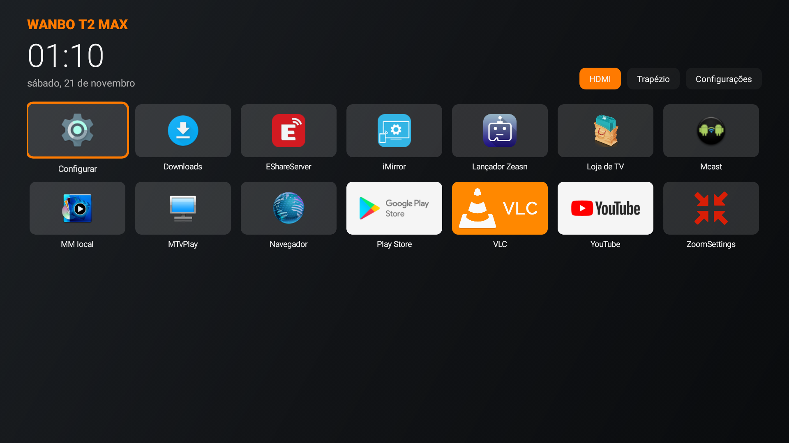
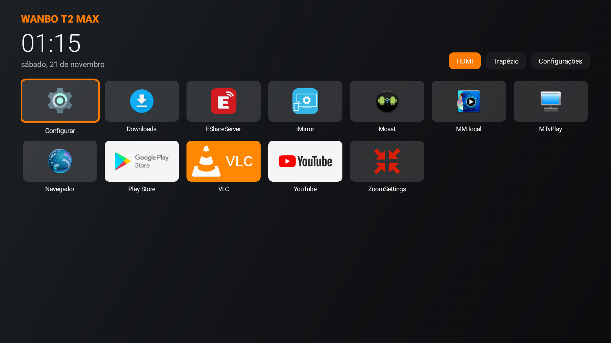
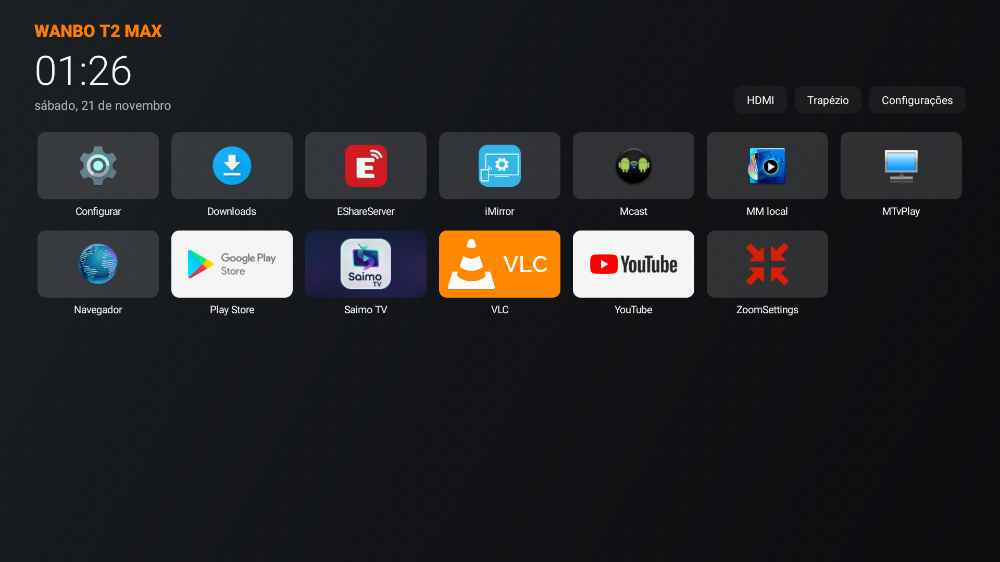
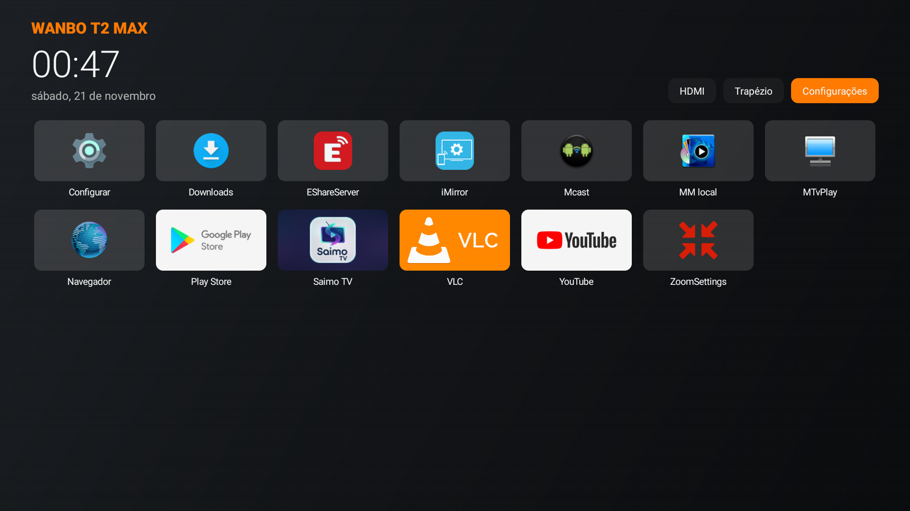

# Guia Passo a Passo: Manutenção, Otimização e Debloat do Projetor Wanbo T2 Max (T2 M+)

> **Guia Técnico de Engenharia Reversa e Customização**  
> **Dispositivo:** Wanbo T2 Max (Modelo `T2 M+`)  
> **Plataforma:** MStar Semiconductor, Inc. (Plataforma Mainz / `msd358`, arquitetura `armeabi-v7a`)  
> **Sistema Operacional:** Android 6.0 Marshmallow (API 23, Kernel 3.10.86)  
> **Resolução:** 1920x1080 (Full HD, 240 dpi)  
> **Memória RAM:** 882 MB (~1 GB)  
> **Autor da Adaptação Wanbo:** [DLMIDIA](https://github.com/DLMIDIA)  

---

## 1. Contexto e Referência Metodológica

Este projeto teve como inspiração metodológica o guia de referência:
* **Documento Base:** *"Projetor HY300: limpeza e otimização com Claude Code"* (Versão 1.0, Novembro de 2026, por **goIAgo / Iago** - [goiago.com](https://goiago.com)).
* **Framework Upstream:** [CleanYourTV](https://github.com/Gathin23/cleanyourtv) por **Gathin23**.

### 🔄 Comparativo: Projetor HY300 vs. Wanbo T2 Max

| Característica | Projetor HY300 (Guia Base goIAgo) | Wanbo T2 Max (Nossa Implementação) |
| :--- | :--- | :--- |
| **SoC / Processador** | Allwinner H713 | MStar Semiconductor Mainz (`msd358`) |
| **Versão Android** | Android 11 (Red Velvet Cake) | Android 6.0 Marshmallow (API 23) |
| **Launcher Stock** | BigdroidOS / Custom Launcher | Zeasn Launcher (`cn.zeasn.launcher`) com banners e anúncios |
| **Controle de Hardware** | Módulos Android padrão | Módulos proprietários MStar TV (`com.mstar.tv.tvplayer.ui`) |
| **Correção Keystone** | Serviço padrão do Android 11 | Aplicativo nativo MStar 4D (`com.example.zoomsettings`) |
| **Launcher Custom** | JM Home / AndroidX Leanback | **Wanbo Home** (16 KB, Java puro, API 23 pura) |
| **Problema Crítico de Fuso** | N/A | Bug histórico do tzdata do Android 6 (horário de verão extinto) |

Ao contrário de outros projetores mais modernos baseados em Android 9 ou 11, o **Wanbo T2 Max (T2 M+)** roda Android 6.0 puro e possui hardware proprietário da MStar. Se os pacotes proprietários da MStar forem removidos incorretamente, o aparelho perde a capacidade de alternar para a entrada HDMI e perde o ajuste ótico de foco e correção de trapézio 4D. Este guia resolve esse desafio mantendo o hardware 100% operacional.

---

## 2. Resultados Alcançados

| Métrica | Antes da Otimização | Depois da Otimização | Ganho Real |
| :--- | :--- | :--- | :--- |
| **Memória RAM Livre** | 173 MB | **252 MB** | **+45% de RAM disponível** |
| **Launcher em Disco** | ~40 MB (Zeasn com cache) | **16 KB** (Wanbo Home) | -99.9% de footprint |
| **Tempo de Boot do Launcher** | ~1.800 ms | **~50 ms** | Inicialização instantânea |
| **Publicidade / Banners** | Sim (Carregados via Wi-Fi) | **Zero (100% limpo)** | Sem telemetria ou propagandas |
| **Horário e Relógio** | +1 hora incorreta (bug de verão) | **Horário exato de Brasília** | Sincronizado via `America/Bahia` |
| **Controle Remoto** | Lentidão e lag de foco | **Resposta imediata (0.0x animação)** | Navegação fluida no D-Pad |

---

## 3. Galeria Visual: Antes e Depois

### 📸 Comparativo Principal: Tela Inicial
| Antes (Launcher Zeasn com Anúncios) | Depois (Wanbo Home Ultraleve e Limpo) |
| :---: | :---: |
|  |  |

### 🚀 Com Aplicativos Instalados e Fuso Horário Corrigido
| Aplicativos Instalados (Ex: Saimo TV) | Fuso Horário e Relógio 100% Sincronizados |
| :---: | :---: |
|  |  |

---

## 4. Passo a Passo Completo da Manutenção

### Etapa 1: Conexão ADB com o Projetor
1. No projetor, vá em **Configurações → Sobre o Dispositivo** e clique 7 vezes sobre o **Número da Versão (Build Number)** para liberar o menu de desenvolvedor.
2. Em **Opções do Desenvolvedor**, ative a **Depuração USB (USB Debugging)**.
3. Conecte seu computador à mesma rede Wi-Fi do projetor e conecte via terminal:
   ```bash
   adb connect <IP_DO_PROJETOR>:5555
   adb devices
   ```
4. Confirme na tela do projetor a autorização da chave RSA da máquina.

---

### Etapa 2: Mapeamento de Hardware e Inventário de Apps
Antes de qualquer modificação, liste todos os aplicativos instalados:
```bash
adb shell pm list packages -f
adb shell getprop | grep -E "ro.product|ro.build"
```

---

### Etapa 3: Backup Integral de Segurança (Golden Backup)
A segurança do hardware vem em primeiro lugar. Execute o script de backup fornecido na pasta `scripts/`:
```bash
chmod +x scripts/backup.sh
./scripts/backup.sh ./backup-wanbo
```

O script extrai automaticamente:
- Lista completa de pacotes instalados e desativados.
- Dump de configurações do sistema (`global`, `secure`, `system`).
- Propriedades completas do Android (`getprop`).
- Tabela e imagens das partições vitais do SoC MStar (`/dev/block/platform/mstar_mci.0/by-name/boot`, `recovery`, `mboot`, etc.).
- Cópia integral de todos os APKs de fábrica que serão modificados.
- Hashes de integridade criptográfica **SHA-256** de todos os arquivos.

---

### Etapa 4: Instalação do Wanbo Home Launcher (16 KB)
Desenvolvemos um launcher nativo em Java puro (código-fonte disponível em `launcher/`), compatível com Android 6.0 (API 23), com suporte nativo a controle remoto e atalhos rápidos de hardware no topo:

```bash
adb install -r launcher/wanbo-launcher.apk
```

Pressione o botão **Home** no controle remoto do projetor, selecione **Wanbo Home** e marque a opção **"Sempre"**.

---

### Etapa 5: Processo de Debloat Seguro
Com o novo launcher instalado e validado, execute a remoção/desativação dos aplicativos de publicidade e telemetria:

```bash
chmod +x scripts/debloat.sh
./scripts/debloat.sh
```

#### Tabela de Pacotes Desativados:
| Pacote | Função Original | Motivo da Remoção |
| :--- | :--- | :--- |
| `cn.zeasn.launcher.vstoresubclient.mstar358` | Launcher Zeasn | Pesado, exibe banners publicitários |
| `cn.zeasn.toptech.projector.msd358.vstoresubclient` | Loja Zeasn | Loja paralela com propagandas |
| `com.zeasn.services.general` | Telemetria Zeasn | Consumo de memória e tráfego de rede |
| `toptech.mid.sugar.appkillerservice` | Task Killer | Mata processos em background de forma agressiva |
| `com.toptech.factorytools` | Utilitários de fábrica | Desnecessário em modo usuário |
| `mstar.factorymenu.ui` | Menu de calibração | Risco de desconfiguração acidental |
| `com.android.inputmethod.pinyin` | Teclado Pinyin | Teclado em chinês desnecessário |
| `com.android.printspooler` | Serviço de impressão | Sem utilidade para um projetor |
| `com.android.galaxy4` | Live wallpaper | Alto consumo de RAM e GPU |
| `com.android.phasebeam` | Live wallpaper | Alto consumo de RAM e GPU |
| `com.android.noisefield` | Live wallpaper | Alto consumo de RAM e GPU |
| `com.android.wallpaper.livepicker` | Seletor de wallpaper | Não utilizado |

#### 🛡️ Hardware Preservado:
- **Zoom & Trapézio Keystone 4D:** `com.example.zoomsettings` (Atalho direto no topo)
- **Entrada HDMI e AV:** `com.mstar.tv.tvplayer.ui` (Atalho direto no topo)
- **Serviços MStar:** `com.mstar.tvsetting` e `com.mstar.tv.service`
- **Espelhamento sem fio:** `EShareServer`, `EAirPlay`, `Mcast`
- **Google Play Store & VLC Player:** Mantidos e funcionando

---

### Etapa 6: Correção do Fuso Horário Brasileiro
O Android 6.0 possui uma base `tzdata` antiga que ainda calcula o antigo horário de verão brasileiro (extinto em 2019), adiantando o relógio em 1 hora incorretamente quando configurado em `America/Sao_Paulo`.

Para corrigir definitivamente sem precisar de root:
```bash
chmod +x scripts/fix_timezone.sh
./scripts/fix_timezone.sh America/Bahia
```
Isso fixa a base de tempo em UTC-3 sem horário de verão, mantendo o relógio e a data do projetor perfeitamente sincronizados.

---

### Etapa 7: Otimizações de Desempenho
Para eliminar qualquer engasgo ao navegar pelos menus, as escalas de animação do sistema são ajustadas para `0.0x`:
```bash
adb shell settings put global window_animation_scale 0.0
adb shell settings put global transition_animation_scale 0.0
adb shell settings put global animator_duration_scale 0.0
```

---

## 5. Como Reverter / Restaurar (Rollback)

Se em qualquer momento você desejar restaurar o estado de fábrica ou reativar qualquer pacote:

```bash
chmod +x scripts/restore.sh
./scripts/restore.sh
```

Ou para reativar um aplicativo específico manualmente:
```bash
adb shell pm enable cn.zeasn.launcher.vstoresubclient.mstar358
```

---

## 6. Referências e Créditos

1. **goIAgo / Iago** ([goiago.com](https://goiago.com)) — Pelo guia de referência *"Projetor HY300: limpeza e otimização com Claude Code"* (v1.0, 2026), que definiu as melhores práticas de backup de partições de firmware e protocolo de aprovação passo a passo.
2. **Gathin23** ([CleanYourTV](https://github.com/Gathin23/cleanyourtv)) — Pela comunidade e repositório central de debloat para Android TV.
3. **DLMIDIA** ([github.com/DLMIDIA](https://github.com/DLMIDIA)) — Diagnóstico e engenharia reversa do hardware MStar Mainz msd358, desenvolvimento do Wanbo Home Launcher em Java nativo, solução do fuso horário brasileiro e publicação dos testes e scripts completos.
