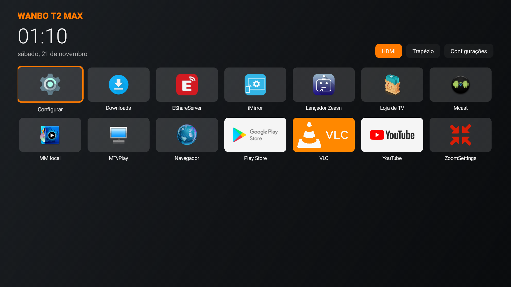
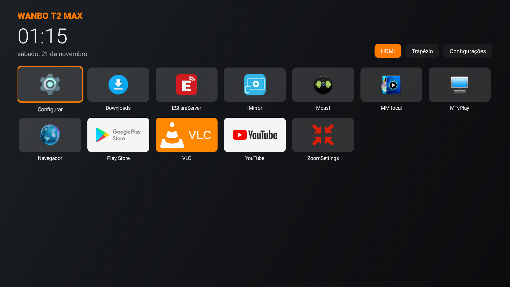
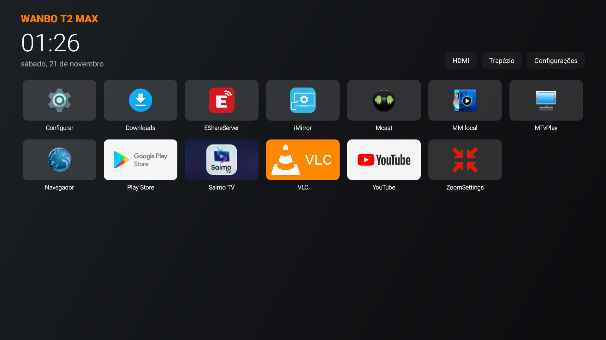
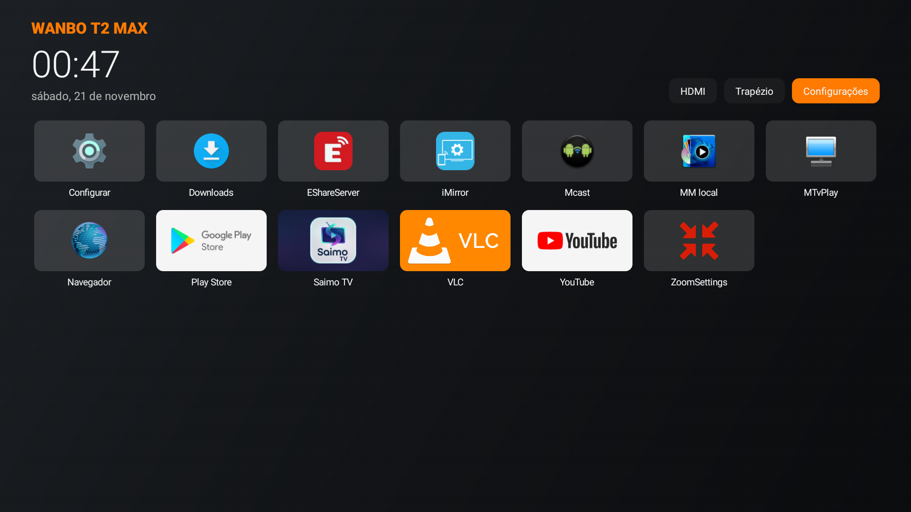

# Wanbo T2 Max (T2 M+) · Guia de Otimização e Debloat

Perfil de otimização, debloat seguro e launcher ultra-leve desenvolvido especificamente para o projetor **Wanbo T2 Max** (plataforma **MStar Mainz / msd358** com Android 6.0 Marshmallow).

---

## 📸 Antes e Depois

| Antes (Launcher de Fábrica com Anúncios Zeasn) | Depois (Wanbo Home Limpo e Rápido) |
| :---: | :---: |
|  |  |

### 🚀 Com Aplicativos Instalados (Ex: Saimo TV) & Horário Corrigido
| Grade de Apps Completa | Horário e Fuso Corrigidos |
| :---: | :---: |
|  |  |

---

## 📊 Resultados Medidos no Aparelho

* **Memória RAM Livre:** Saltou de **173 MB** para **252 MB** (**+45% de RAM disponível**).
* **Tempo de Resposta da Interface:** Animações reduzidas para `0.0x`, resposta instantânea ao controle remoto.
* **Tamanho do Launcher Novo:** Apenas **16 KB** compilado em Java puro (contra dezenas de megabytes do launcher original).
* **Fuso Horário Corrigido:** Ajustado para `America/Bahia` (UTC-3) contornando o bug histórico do Android 6 que ativava horário de verão extinto.

---

## 🛡️ O Que Foi Mantido Intacto (Hardware e Recursos)
* **Zoom e Keystone 4D (Correção de Trapézio):** `com.example.zoomsettings` mantido com atalho direto no topo.
* **Entrada HDMI e AV:** `com.mstar.tv.tvplayer.ui` mantido com atalho direto no topo.
* **Drivers de Imagem e Áudio:** MStar TV Services intactos.
* **Espelhamento de Tela:** EShare, AirPlay e Wi-Fi Display funcionais.
* **Google Play Store & VLC:** 100% preservados.

---

## 🛑 O Que Foi Removido / Desativado (Bloatware)
Consulte o arquivo [`debloat.txt`](debloat.txt) para a lista exata dos pacotes removidos (Loja Zeasn, telemetria, AppKiller, ferramentas de calibração de fábrica e live wallpapers pesados).

---

## 🙏 Créditos e Agradecimentos
* **Gathin23** ([CleanYourTV](https://github.com/Gathin23/cleanyourtv)) - Estrutura e metodologia de debloat para TVs e projetores Android.
* **goIAgo / Iago** ([goiago.com](https://goiago.com)) - Pelo excelente guia base do projetor HY300 com Claude Code.
* **DLMIDIA / Daniel Silva** ([github.com/DLMIDIA](https://github.com/DLMIDIA)) - Diagnóstico, engenharia reversa do Wanbo T2 Max, criação do launcher personalizado em Java puro, correção do fuso horário brasileiro e documentação.
